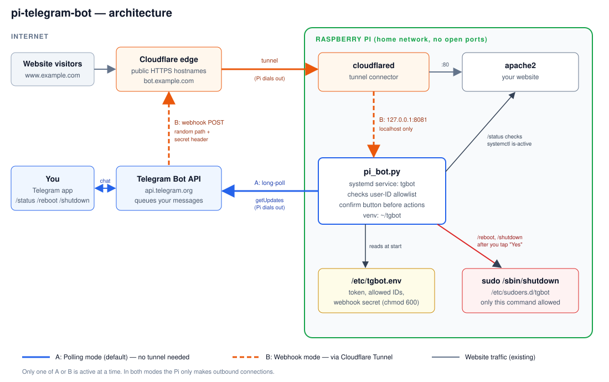

# pi-telegram-bot

Control your Raspberry Pi from your phone with Telegram: check its status, reboot it, or shut it down safely, from anywhere, without opening any ports on your router.



## Contents

- [Features](#features)
- [How it works](#how-it-works)
- [Requirements](#requirements)
- [Step 1: Create your Telegram bot](#step-1-create-your-telegram-bot)
- [Step 2: Find your Telegram user ID](#step-2-find-your-telegram-user-id)
- [Step 3: Install on the Pi](#step-3-install-on-the-pi)
- [Step 4: Test it](#step-4-test-it)
- [Optional: Webhook mode with Cloudflare Tunnel](#optional-webhook-mode-with-cloudflare-tunnel)
- [Configuration reference](#configuration-reference)
- [Adding your own commands](#adding-your-own-commands)
- [Updating](#updating)
- [Performance](#performance)
- [Security](#security)
- [Troubleshooting](#troubleshooting)
- [Uninstall](#uninstall)

## Features

| Command | What it does |
|---|---|
| `/start` | Shows the command list. For an unknown user, replies with their Telegram user ID. |
| `/status` | Uptime, CPU temperature, Apache status, root disk usage |
| `/reboot` | Restarts the Pi, after you tap a **Yes** confirmation button |
| `/shutdown` | Powers off the Pi, after you tap a **Yes** confirmation button |

- Only Telegram user IDs you allow can run commands. Everyone else is ignored and logged.
- Runs as a systemd service, so it starts on boot and restarts if it crashes.
- Two connection modes: **polling** (default, zero setup) or **webhook** (through a Cloudflare Tunnel).
- Easy to extend with your own commands.

## How it works

You send a command to your bot in the Telegram app. Telegram's servers hold the message until the bot on your Pi picks it up:

- **Mode A: Polling (default).** The bot keeps one long-running HTTPS request open to `api.telegram.org`. When you send a message, Telegram answers that request immediately. The Pi only makes **outbound** connections, so no router or firewall changes are needed.
- **Mode B: Webhook.** Telegram pushes each message to a public HTTPS address (e.g. `https://bot.example.com/tg-<random>`). Cloudflare forwards it through your existing **Cloudflare Tunnel** to the bot, which listens only on `127.0.0.1:8081`. The tunnel is also an outbound connection from the Pi.

Before running `/reboot` or `/shutdown`, the bot checks your user ID and asks for confirmation. It then runs `sudo /sbin/shutdown`, which is the **only** command it's allowed to run as root.

## Requirements

- A Raspberry Pi running Raspberry Pi OS (Bookworm or newer) or another Debian-based OS with systemd
- Python 3.9 or newer (included with Raspberry Pi OS)
- Internet access from the Pi
- A user account with `sudo` rights (e.g. `pi`)
- The Telegram app on your phone
- For webhook mode only: a domain on Cloudflare with `cloudflared` already set up on the Pi

## Step 1: Create your Telegram bot

1. Open Telegram and search for **@BotFather** (the official one has a blue check mark).
2. Send `/newbot`.
3. Enter a display name, e.g. `My Pi`.
4. Enter a username ending in `bot`, e.g. `my_home_pi_bot`.
5. BotFather replies with a **token** like `123456789:AAH...`. Copy it.

> ⚠️ The token gives full control of your bot. Don't share it, post it, or commit it to git. If it leaks, send `/revoke` to @BotFather to get a new one.

Optional but recommended, in @BotFather:
- `/setcommands`, pick your bot, then paste:
  ```
  status - Uptime, temperature, Apache, disk
  reboot - Restart the Pi
  shutdown - Power off the Pi
  ```
  This gives you a tap-able command menu in the chat.
- `/setjoingroups` → **Disable**, so nobody can add your bot to groups.

## Step 2: Find your Telegram user ID

Your user ID is a number (not your @username). Either:

- Message **@userinfobot** in Telegram, and it replies with your ID, **or**
- Skip this for now. After installing, send `/start` to your own bot and it will tell you your ID.

## Step 3: Install on the Pi

Connect to your Pi (e.g. `ssh pi@raspberrypi.local`), then run:

```bash
sudo apt-get update && sudo apt-get install -y git
git clone https://github.com/pbrajesh/pi-telegram-bot.git
cd pi-telegram-bot
bash install.sh
```

> Run `install.sh` as your **normal user**, not with `sudo`. It asks for your password when it needs root.

The installer asks three questions:

| Prompt | What to enter |
|---|---|
| Bot token | The token from Step 1 (hidden as you paste) |
| Telegram user ID | Your ID from Step 2. For several people, separate with commas: `111,222`. Can be left blank. |
| Webhook hostname | **Leave blank** for polling mode. See [webhook mode](#optional-webhook-mode-with-cloudflare-tunnel) otherwise. |

It then:

1. Installs `python3-venv` and creates a virtual environment in `~/tgbot`
2. Installs the [`python-telegram-bot`](https://python-telegram-bot.org/) library
3. Copies `pi_bot.py` to `~/tgbot/`
4. Saves your settings to `/etc/tgbot.env`, readable only by root (`chmod 600`)
5. Adds `/etc/sudoers.d/tgbot`, allowing your user to run **only** `/sbin/shutdown` without a password (checked with `visudo` first)
6. Creates, enables and starts the `tgbot` systemd service

At the end you should see **✅ Bot is running**.

**If you left the user ID blank:** send `/start` to your bot. It replies `Your user ID is 123456789. Not authorized.` Then add it:

```bash
sudo nano /etc/tgbot.env        # set ALLOWED_IDS=123456789
sudo systemctl restart tgbot
```

## Step 4: Test it

In Telegram, open your bot and send:

1. `/start` shows the command list
2. `/status` shows uptime, temperature, Apache state and disk usage
3. `/reboot` shows **Yes / Cancel** buttons. Tap **Yes** to confirm the full flow works. The Pi is back in about a minute and the bot starts automatically.

Watch the logs live while testing:

```bash
journalctl -u tgbot -f
```

## Optional: Webhook mode with Cloudflare Tunnel

Use this if you already run `cloudflared` on the Pi and want Telegram to push messages instead of the bot polling. Polling works fine for most people, so this is optional.

### 1. Pick a hostname

Use a dedicated subdomain such as `bot.example.com`, separate from your website.

### 2. Route it to the bot

The bot listens on `http://localhost:8081`.

**If your tunnel is managed in the Cloudflare dashboard:**

1. Go to **Zero Trust → Networks → Tunnels**, select your tunnel, then **Public Hostname → Add a public hostname**.
2. Subdomain: `bot`. Domain: your domain. Path: leave empty.
3. Service type: `HTTP`. URL: `localhost:8081`.
4. Save.

**If your tunnel uses a local `config.yml`** (usually `/etc/cloudflared/config.yml` or `~/.cloudflared/config.yml`), add a rule **above** the final catch-all rule:

```yaml
ingress:
  - hostname: www.example.com          # your existing site
    service: http://localhost:80
  - hostname: bot.example.com          # new: the bot
    service: http://localhost:8081
  - service: http_status:404           # must stay last
```

Then create the DNS record and restart:

```bash
cloudflared tunnel route dns <your-tunnel-name> bot.example.com
sudo systemctl restart cloudflared
```

### 3. Run the installer with the hostname

```bash
cd ~/pi-telegram-bot
bash install.sh
```

When asked for the webhook hostname, enter `bot.example.com` (no `https://`, no path). The installer generates:

- a random URL path, e.g. `https://bot.example.com/tg-3f9a...`
- a random `WEBHOOK_SECRET` that Telegram sends in a header with every request. Requests without it are rejected.

On startup the bot registers this URL with Telegram automatically. The log shows `Webhook mode on 127.0.0.1:8081/tg-...`.

### 4. Check delivery

Get your token with `sudo grep BOT_TOKEN /etc/tgbot.env`, then open in a browser:

```
https://api.telegram.org/bot<TOKEN>/getWebhookInfo
```

A healthy result shows your URL, `"pending_update_count": 0`, and no `last_error_message`.

### Cloudflare settings that can block Telegram

| Setting | What to do |
|---|---|
| **Cloudflare Access** (Zero Trust login) | Don't apply an Access policy to the bot hostname. Telegram can't log in. |
| **Bot Fight Mode / WAF / "Under attack"** | If `getWebhookInfo` shows `403` or `Wrong response from the webhook`, add a WAF custom rule to **Skip** for `hostname eq bot.example.com`. You can also restrict it to Telegram's IP ranges `149.154.160.0/20` and `91.108.4.0/22`. |
| **SSL/TLS** | The public side is HTTPS (Cloudflare handles it). The tunnel-to-bot side is plain HTTP on localhost, which is expected. |

### Switching back to polling

```bash
sudo nano /etc/tgbot.env        # make it: WEBHOOK_URL=
sudo systemctl restart tgbot
```

The bot removes the webhook from Telegram automatically when polling starts. Note that in webhook mode the bot depends on the tunnel. If `cloudflared` is down, commands won't arrive until it's back, while polling only needs internet access.

## Configuration reference

Settings live in `/etc/tgbot.env` on the Pi (see [`tgbot.env.example`](tgbot.env.example)). After editing, run `sudo systemctl restart tgbot`.

| Variable | Required | Description |
|---|---|---|
| `BOT_TOKEN` | Yes | Token from @BotFather |
| `ALLOWED_IDS` | Yes | Comma-separated Telegram user IDs allowed to use commands |
| `WEBHOOK_URL` | No | Full public webhook URL. Empty means polling mode. |
| `WEBHOOK_SECRET` | No | Secret header value Telegram must send (webhook mode). Letters, digits, `_` and `-` only. |
| `LISTEN_PORT` | No | Local port in webhook mode (default `8081`) |

Files the installer creates:

| Path | Purpose |
|---|---|
| `~/tgbot/pi_bot.py` | The running bot |
| `~/tgbot/venv/` | Python virtual environment |
| `/etc/tgbot.env` | Secrets and settings (root only) |
| `/etc/sudoers.d/tgbot` | Allows only `/sbin/shutdown` without a password |
| `/etc/systemd/system/tgbot.service` | Auto-start service |

## Adding your own commands

Edit `pi_bot.py` in the repo. Example: a `/restart_apache` command.

1. Add a handler. Always start with the `authorized` check:

   ```python
   async def restart_apache(update: Update, context: ContextTypes.DEFAULT_TYPE):
       if not authorized(update):
           return
       out = run(["sudo", "/usr/bin/systemctl", "restart", "apache2"])
       state = run(["systemctl", "is-active", "apache2"])
       await update.message.reply_text(f"Apache restarted: {state} {out}")
   ```

2. Register it in `main()`, next to the other handlers:

   ```python
   app.add_handler(CommandHandler("restart_apache", restart_apache))
   ```

3. If the command uses `sudo`, allow **exactly** that command (use the full path):

   ```bash
   sudo visudo -f /etc/sudoers.d/tgbot
   ```
   and add:
   ```
   pi ALL=(root) NOPASSWD: /usr/bin/systemctl restart apache2
   ```
   Replace `pi` with your username. Never allow broad commands like `ALL` or `/bin/bash`.

4. Redeploy with `bash install.sh`, or for a quick test:
   ```bash
   cp pi_bot.py ~/tgbot/pi_bot.py && sudo systemctl restart tgbot
   ```

5. Optionally add the command to the menu with `/setcommands` in @BotFather.

> Note: re-running `install.sh` rewrites `/etc/sudoers.d/tgbot`, so extra sudo rules you add there are reset. Keep them in a separate file, e.g. `sudo visudo -f /etc/sudoers.d/tgbot-extra`.

## Updating

```bash
cd ~/pi-telegram-bot
git pull
bash install.sh
```

The installer asks for the token again and rewrites the settings, so keep your token handy.

## Performance

Very light. It won't affect Apache or other services.

- **CPU:** near 0% when idle
- **RAM:** about 30–60 MB (mostly the Python runtime)
- **Network:** one long-poll request about every 50 seconds when idle, a few MB per day at most
- **SD card:** almost no writes (routine HTTP logging is turned off)

To put hard limits on it anyway, add under `[Service]` in `/etc/systemd/system/tgbot.service`:

```ini
MemoryMax=100M
CPUQuota=20%
Nice=10
```

Then run `sudo systemctl daemon-reload && sudo systemctl restart tgbot`.

## Security

- **No credentials in this repo.** The token and secrets are typed in at install time and stored only in `/etc/tgbot.env` (owner root, mode 600). `.gitignore` blocks `*.env` files.
- **Allowlist.** Anyone can find and message a Telegram bot. Only IDs in `ALLOWED_IDS` are obeyed, and rejected attempts are logged.
- **Confirmation step** before reboot and shutdown, so an accidental tap doesn't take the Pi down.
- **Least privilege.** The bot runs as your normal user. sudo is limited to `/sbin/shutdown`.
- **No inbound ports.** Polling and Cloudflare Tunnel both connect outbound.
- **Webhook hardening.** It listens on localhost only, with a random URL path and a secret header check.

To see rejected users: `journalctl -u tgbot | grep Rejected`

## Troubleshooting

| Symptom | Check / fix |
|---|---|
| Installer says the service didn't start | `journalctl -u tgbot -n 50` shows the error |
| `KeyError: 'BOT_TOKEN'` in logs | `/etc/tgbot.env` is missing or empty. Re-run `bash install.sh`. |
| `InvalidToken` / `Unauthorized` | The token is wrong or was revoked. Get a new one from @BotFather and re-run the installer. |
| Bot replies "Not authorized" | Your ID isn't in `ALLOWED_IDS`. Add it and restart the service. |
| Bot doesn't reply at all | Run `systemctl status tgbot`. Check the Pi's internet with `ping -c3 api.telegram.org`. |
| `/reboot` says rebooting, but nothing happens | Run `sudo -l` and confirm `/sbin/shutdown` is listed as NOPASSWD. Check `ls /etc/sudoers.d/tgbot`. |
| Temperature shows an error | `vcgencmd` is missing (non-Raspberry Pi OS). It's harmless. |
| Webhook: messages don't arrive | Check `getWebhookInfo` (see above), the tunnel route to `localhost:8081`, and Cloudflare Access/WAF settings. |
| `Conflict: terminated by other getUpdates request` | Two copies of the bot are running with the same token. Stop the extra one. |

Useful commands:

```bash
systemctl status tgbot           # is it running?
journalctl -u tgbot -f           # live logs
sudo systemctl restart tgbot     # restart after config changes
sudo systemctl stop tgbot        # stop temporarily
```

## Uninstall

```bash
sudo systemctl disable --now tgbot
sudo rm /etc/systemd/system/tgbot.service /etc/sudoers.d/tgbot /etc/tgbot.env
sudo systemctl daemon-reload
rm -rf ~/tgbot
```

If you used webhook mode, also remove the `bot` hostname from your Cloudflare Tunnel.

## License

[MIT](LICENSE)
